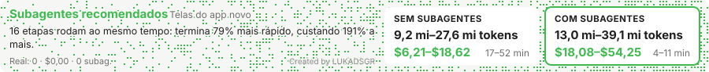
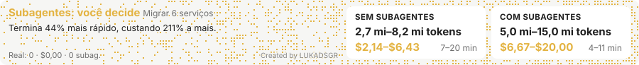
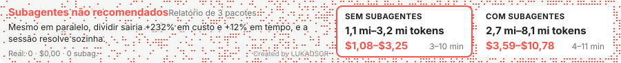
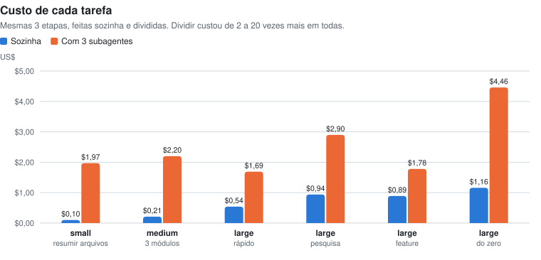
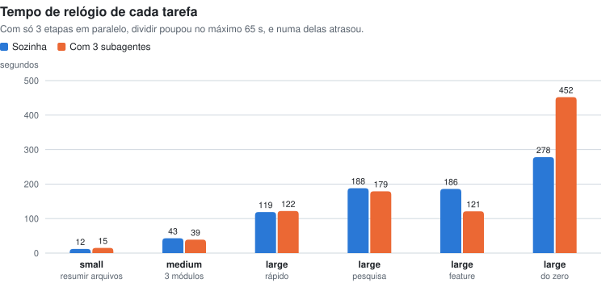
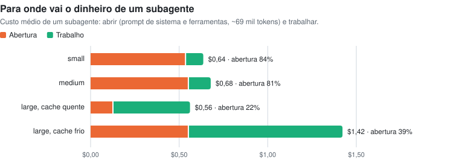
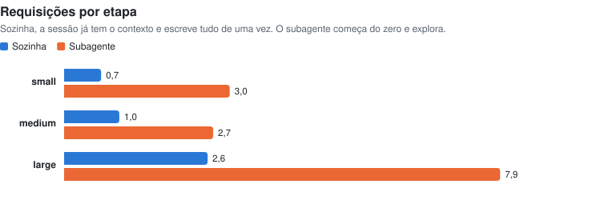
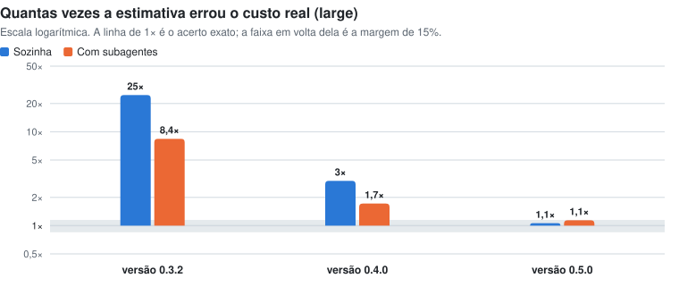

# subagent-advisor

**Vale a pena dividir uma tarefa entre subagentes?** Comecei este projeto com uma intuição: se uma tarefa tem partes independentes, rodar essas partes em paralelo, cada uma num subagente, deveria ser mais rápido e talvez até mais barato. Construí um mod para o Claude Code que responde a essa pergunta antes de cada tarefa. Depois fui medir se ele acertava.

Ele não acertava. E o que as medições mostraram mudou a minha resposta para a pergunta original.

Esta página é o registro dessa pesquisa.

Created by LUKADSGR.

---

## O mod

O subagent-advisor entra em ação no começo de uma tarefa que já se divide em duas ou mais etapas capazes de rodar ao mesmo tempo. O Claude informa quantas etapas a tarefa tem, quantas são independentes, quanto ela precisa ler e se é arriscada. O mod calcula os dois caminhos, **sozinha** e **com subagentes**, e mostra uma faixa acima do campo de mensagem com tokens, dólares e tempo de cada um:

| Cor | Veredito | Quando |
| --- | --- | --- |
| Verde | Subagentes recomendados | Termina na metade do tempo ou menos, poupando 2 min ou mais, por até 3 vezes o custo |
| Amarelo | Subagentes: você decide | Termina 30% antes, poupando 2 min ou mais, por até 4 vezes o custo; ou a tarefa é arriscada e ganha uma revisão independente |
| Vermelho | Subagentes não recomendados | Dividir custaria mais sem ganho de tempo que compense |

Essas regras são o resultado da pesquisa abaixo. A primeira versão tinha outras.

Assim a faixa aparece no Claude Code, com os números que o mod calcula hoje para três tarefas:

**Verde:** 16 telas de um app novo, todas independentes. Dividir custa quase o triplo, mas termina em um quinto do tempo.

<picture>
  <source media="(prefers-color-scheme: dark)" srcset="docs/research/band-green-dark.svg">
  
</picture>

**Amarelo:** migrar 6 serviços. Termina bem antes, mas pagando 3 vezes mais, então a escolha fica com você.

<picture>
  <source media="(prefers-color-scheme: dark)" srcset="docs/research/band-yellow-dark.svg">
  
</picture>

**Vermelho:** um relatório sobre 3 pacotes, como a tarefa de pesquisa medida abaixo. Dividir custaria mais que o triplo e não terminaria antes.

<picture>
  <source media="(prefers-color-scheme: dark)" srcset="docs/research/band-red-dark.svg">
  
</picture>

Cada cartão mostra uma faixa: do caso típico até 3 vezes ele. O cartão em destaque é o caminho que o mod recomenda. Na faixa de verdade, os botões **Sem subagentes** e **Com subagentes** aparecem logo abaixo, e a linha "Real" vai somando o que a tarefa gasta enquanto roda.

---

## Como medi

Uma estimativa só vale alguma coisa se for comparada com a realidade. Por isso montei um experimento simples e repetível:

1. **Uma tarefa, duas execuções.** Cada tarefa tinha 3 etapas independentes. Primeiro, 3 subagentes fizeram uma etapa cada, em paralelo. Depois, a sessão principal fez as mesmas 3 etapas sozinha. Nessa ordem, a sessão não tinha visto o trabalho dos subagentes.
2. **Avaliação antes do trabalho.** Antes de começar, a sessão anotava a avaliação que daria ao mod (etapas, leitura, tamanho), como num uso real, e não podia corrigir depois.
3. **Gasto medido por requisição.** Os tokens foram somados direto dos transcripts, requisição por requisição, e convertidos em dólares pela tabela de preços do modelo.
4. **Seis tarefas, de três tamanhos:**

| Tamanho | Tarefa | O que as 3 etapas faziam |
| --- | --- | --- |
| small | resumir arquivos | ler e resumir 3 arquivos do próprio mod |
| medium | 3 módulos | fila de prioridade, cache LRU e parser de CSV, com testes |
| large | rápido | conversor de Markdown, linguagem de expressões e Lig 4 com IA |
| large | pesquisa | relatório técnico do código de express, commander e marked |
| large | feature | funcionalidades novas dentro de mitt, ms e yargs-parser, com testes |
| large | do zero | roteador HTTP, validador de JSON Schema e jogo de estratégia com IA |

Todas as tarefas rodaram no mesmo modelo, Claude Opus 5.5, com preços de tabela: US$ 4 por milhão de tokens de entrada, 20 de saída, 0,20 de leitura em cache e 8 de escrita em cache.

---

## O que encontrei

### 1. Dividir sempre custou mais

Em nenhuma das seis tarefas os subagentes saíram mais baratos. Nas tarefas pequenas, a diferença foi de 10 a 20 vezes; nas grandes, de 2 a 4.

<picture>
  <source media="(prefers-color-scheme: dark)" srcset="docs/research/cost-dark.svg">
  
</picture>

### 2. E quase nunca ficou mais rápido

Esta foi a maior surpresa. Rodar em paralelo deveria cortar o tempo para cerca de um terço. Não cortou: o melhor caso poupou 65 segundos. Num dos casos, os subagentes demoraram mais, porque o mais lento dos três segurou o resultado de todos.

<picture>
  <source media="(prefers-color-scheme: dark)" srcset="docs/research/time-dark.svg">
  
</picture>

### 3. Por quê: todo subagente começa do zero

Um subagente não herda o contexto da sessão. Antes de fazer qualquer coisa, ele carrega o prompt de sistema e a descrição de todas as ferramentas: cerca de **69 mil tokens**, medidos em todos os 21 subagentes do experimento. Numa tarefa pequena, essa abertura é mais de 80% do custo do subagente.

Existe um alívio. Se outro subagente rodou há pouco, a maior parte da abertura já está em cache e sai cerca de 4 vezes mais barata. Isso aconteceu em metade das execuções.

<picture>
  <source media="(prefers-color-scheme: dark)" srcset="docs/research/anatomy-dark.svg">
  
</picture>

### 4. A sessão sozinha é mais eficiente do que eu imaginava

A sessão principal já sabe onde está e o que precisa. Ela lê só as partes que importam, de 40% a 50% do que a tarefa parecia exigir, e costuma escrever o código de uma vez. Os subagentes exploram mais, leem 1,4 vezes o que foi previsto e escrevem o dobro. Fazem cerca de 3 vezes mais requisições por etapa.

<picture>
  <source media="(prefers-color-scheme: dark)" srcset="docs/research/requests-dark.svg">
  
</picture>

Reler o contexto também sai barato: o que já está em cache custa 1/40 do preço de ler pela primeira vez. Por isso, uma sessão com o contexto cheio não é, por si só, motivo para dividir.

---

## O mod estava errado, e como corrigi

A primeira versão do mod foi calibrada com dados de transcripts antigos, e superestimava tudo. Descobri que cada requisição aparece repetida em cerca de 2,25 linhas no transcript da sessão principal. Contadas sem tirar as repetições, as tarefas pareciam muito maiores do que eram. Corrigi isso e recalibrei o mod três vezes, cada vez com mais medições.

<picture>
  <source media="(prefers-color-scheme: dark)" srcset="docs/research/accuracy-dark.svg">
  
</picture>

Na versão atual (0.5.0), a estimativa para tarefas `large` fica a até 15% da média real das quatro tarefas medidas:

| | Tokens | Custo | Tempo |
| --- | --- | --- | --- |
| Sozinha | +12% | +6% | +1% |
| Com subagentes | +1% | +14% | 0% |

O que mudou no modelo:

- **Sozinha e com subagentes têm números próprios.** Cada caminho tem a sua quantidade de requisições, de leitura e de escrita por etapa.
- **Toda saída é cobrada duas vezes.** Cada token gerado é gravado de novo no cache para a próxima requisição ler.
- **Abertura em cache, metade das vezes.** O custo de abrir um subagente considera que ele encontra o cache já aquecido em metade das execuções.
- **O veredito pesa o tempo.** Como dividir sempre custou mais, só faz sentido quando o tempo ganho compensa.

---

## O que concluí

> **Na maior parte das tarefas, a sessão sozinha resolve mais barato e em tempo parecido.**

- **Não vale dividir:** tarefas pequenas e médias, ou tarefas de 2 a 4 etapas, mesmo que independentes. A abertura de cada subagente come qualquer ganho.
- **Pode valer dividir:** muitas etapas grandes rodando ao mesmo tempo (umas 6 a 10 ou mais), quando terminar antes importa mais que pagar 2 ou 3 vezes mais.
- **Vale por outros motivos:** uma revisão independente numa mudança arriscada, ou manter a sessão principal leve quando ela está perto do limite de contexto. São motivos legítimos, só não são economia.

Sobre ferramentas que organizam subagentes, como o `/savvy-flow` do [claude-kit](https://github.com/johnnyvizz/claude-kit), que o mod sugere quando dividir compensa: os testes usaram os subagentes nativos do Claude Code, não o savvy-flow. Como ele também cria subagentes, a mesma abertura de cerca de 69 mil tokens por subagente deve valer para ele. Isso é uma inferência, não uma medição. A tabela de preços do mod vem do savvy-progress, de 10/10/2026.

---

## Limites desta pesquisa

Prefiro ser claro sobre o que estes números não dizem:

- **Poucas amostras.** São 6 tarefas: uma `small`, uma `medium` e quatro `large`. É o bastante para mostrar a direção, não para fechar a questão.
- **Tarefas de laboratório.** Foram tarefas montadas para o teste. Trabalho real, que explora um código grande e desconhecido, pode favorecer um pouco mais os subagentes.
- **Variação grande.** Duas tarefas `large` com a mesma avaliação custaram US$ 1,69 e US$ 4,46 com subagentes. O mod acerta a média, não cada caso.
- **Um modelo só.** Todas as medições foram no Claude Opus 5.5. Com outros modelos e preços, as proporções mudam.
- **Um ponto fora da curva.** Uma sessão real de pesquisa, de antes deste experimento, levou mais de 48 minutos e US$ 16. A faixa atual do mod cobre o custo dela, mas não o tempo.

---

## Os dados

Todos os números desta página, para quem quiser conferir ou refazer:

| Tarefa | Avaliação (leitura) | Sozinha: tokens · US$ · s | Com subagentes: tokens · US$ · s |
| --- | --- | --- | --- |
| small · resumir arquivos | 9 mil | 203 mil · 0,10 · 12 | 760 mil · 1,97 · 15 |
| medium · 3 módulos | 3 mil | 290 mil · 0,21 · 43 | 770 mil · 2,20 · 39 |
| large · rápido | 3 mil | 528 mil · 0,54 · 119 | 1,30 mi · 1,69 · 122 |
| large · pesquisa | 70 mil | 934 mil · 0,94 · 188 | 2,73 mi · 2,90 · 179 |
| large · feature | 23 mil | 1,37 mi · 0,89 · 186 | 1,98 mi · 1,78 · 121 |
| large · do zero | 3 mil | 869 mil · 1,16 · 278 | 3,64 mi · 4,46 · 452 |

Medido em 08/11/2026. Os tokens somam tudo, inclusive releituras em cache. Na tarefa `small`, a sessão sozinha já tinha dois dos arquivos no contexto, o que a deixou mais barata do que ficaria começando do zero.

Os gráficos são gerados por [`docs/research/make_charts.py`](docs/research/make_charts.py). O código do mod não fica neste repositório: ele é distribuído à parte.

## Licença

Todos os direitos reservados a LUKADSGR. Você pode ler esta pesquisa e citar trechos curtos com crédito e link para este repositório. Usar, copiar, modificar ou distribuir o mod ou esta pesquisa exige uma licença, como a adquirida na compra do mod. Os detalhes estão em [`LICENSE`](LICENSE).
